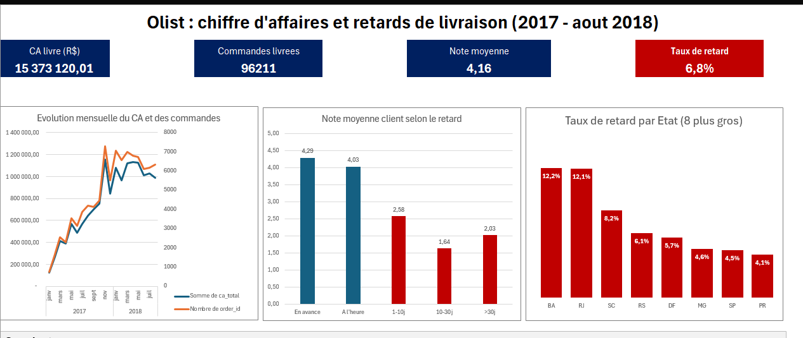

# Analyse e-commerce Olist : augmenter le chiffre d'affaires et réduire les retards de livraison

Analyse de bout en bout de 99 092 commandes d'un e-commerce brésilien (janvier 2017 - août 2018), réalisée avec **Excel et Power Query** : nettoyage des données, tableaux croisés dynamiques, tableau de bord et priorisation des actions.

## Question métier

> **Comment augmenter le chiffre d'affaires et réduire les retards de livraison ?**

Elle est décomposée en quatre sous-questions :

1. Comment évoluent les ventes dans le temps, par catégorie et par État ?
2. Quels facteurs expliquent le montant d'une commande ?
3. Les retards de livraison dégradent-ils les notes clients ?
4. Quelles actions prioriser, avec quel impact chiffré ?

## Aperçu du tableau de bord



## Résultats principaux

| Indicateur | Valeur |
|---|---|
| Commandes analysées | 99 092 (96 211 livrées) |
| Chiffre d'affaires des commandes livrées | 15,37 M R$ |
| Croissance du CA, janvier-août 2018 vs 2017 | **+143 %** |
| Commandes livrées en retard | **6,8 %** (6 531) |
| Note moyenne : à l'heure / en retard | environ 4,3 / environ 2,3 |
| CA des commandes touchées par un retard | 1,15 M R$ (7,5 % du CA) |

**Ce que montre l'analyse :**

- **Ventes** : trois États (SP, RJ, MG) font 62,6 % du CA. Le pic de ventes est en novembre 2017.
- **Montant d'une commande** : il dépend surtout du produit (de 124 à 476 R$ de moyenne selon la catégorie), très peu du nombre d'articles (corrélation de 0,15 ; 90 % des commandes n'ont qu'un article). La région agit surtout sur les frais de port.
- **Retards et satisfaction** : un retard fait perdre environ 2 points de note, partout au Brésil.
- **Priorité géographique** : Rio de Janeiro concentre 22 % du CA touché par un retard pour 13 % du CA, avec un taux de retard de 12 % contre 4,5 % à São Paulo. Ramener RJ au niveau de SP éviterait environ 940 retards. Le Nordeste a aussi des taux élevés, mais pour de petits volumes.
- **La catégorie de produit n'explique pas les retards** : le taux varie peu entre les grandes catégories.

## Méthode

1. **Cadrage** : définition des indicateurs (CA = montant + frais de port ; retard = livraison après la date promise ; analyses sur les commandes livrées).
2. **Import et nettoyage avec Power Query** : encodage UTF-8, gestion des guillemets, locale des nombres et des dates, typage explicite des colonnes.
3. **Colonnes calculées** : indicateur de retard (1/0), tranches de retard, CA total, mois.
4. **Analyse** : tableaux croisés dynamiques par catégorie, État, ville et période ; corrélation ; croisement du CA et du taux de retard.
5. **Restitution** : tableau de bord Excel et onglet de notes documentant les choix.

## Structure du dépôt

```
.
├── README.md
├── excel_orders_analysis.xlsx   # classeur : Notes, Data, TCD 1 à 12, Analyses, Dashboard
<!-- ├── dashboard.pdf                # export du tableau de bord -->
├── images/                      # captures utilisées dans ce README
└── data/                        # [données d'origine, si tu les ajoutes]
```

## Outils

Excel (tableaux structurés, tableaux et graphiques croisés dynamiques, `SOMME.SI.ENS`, `MOYENNE.SI.ENS`, `NB.SI.ENS`, `COEFFICIENT.CORRELATION`), Power Query (langage M).

## Limites

- Les impacts chiffrés sont des **hypothèses** : on suppose qu'une commande évitée en retard aurait la note d'une commande livrée à l'heure.
- Le CA touché par un retard n'est **pas** du CA perdu : le fichier n'identifie pas les clients, donc l'effet sur les achats futurs n'est pas mesurable.
- Les causes des retards (transporteur, entrepôt, distance) ne sont pas dans les données.
- Le volet « augmenter le CA » reste descriptif (où et quand le CA se fait) ; seule la partie retards débouche sur une priorité chiffrée.
- Les États à très faible volume (AP, AM, AC, RR) ont des taux peu fiables et sont écartés des conclusions.
- La période démarre avec une activité faible début 2017 (montée en charge) et s'arrête en août 2018.

## Données

Jeu de données dérivé du jeu public Olist (e-commerce brésilien) : https://www.kaggle.com/datasets/olistbr/brazilian-ecommerce

## Auteur

**DONGMO FEUDJIO Divin Virlence** : Analyste de données junior
[Portfolio](https://dongmo-feudjio-portfolio.netlify.app) · [LinkedIn](https://www.linkedin.com/in/virlence-dongmo-a2286030a)